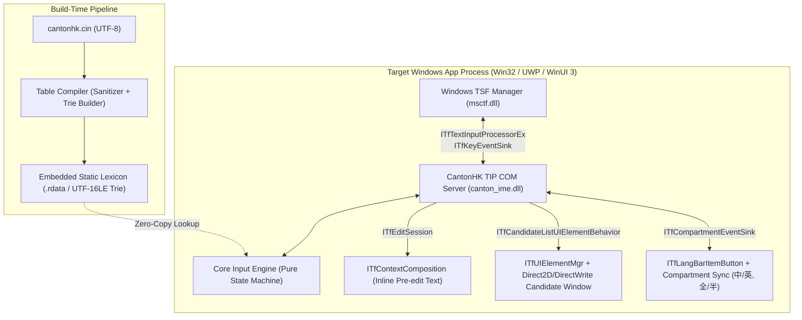
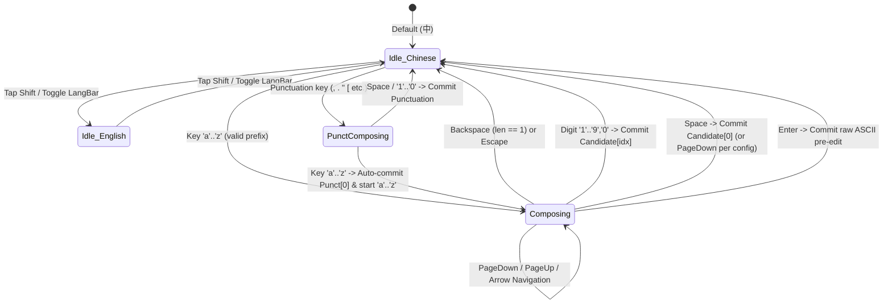

# RFC-0001: CantonHK Windows 10/11 Native Input Method Engine (TSF TIP)

- **Status:** Accepted / Ready for Implementation
- **Target Audience:** Autonomous LLM Coding Agents, Vibe-Coding Sessions, and Systems Engineers
- **Primary Input Asset:** `C:\Users\kuro\Dev\canton-im\assets\cantonhk.cin`
- **Target OS:** Windows 10 (1809+) and Windows 11 (21H2–24H2+), x64 & x86 (with ARM64 portability)
- **Subsystem:** Windows Text Services Framework (TSF / `msctf.dll`) In-Process COM DLL + Direct2D/DirectWrite UI

---

## 1. Executive Summary & Handover Context (For Future LLM Agents)

If you are an LLM coding agent picking up this project, read this section first:

1. **Goal:** Build and compile a native Windows 10 / Windows 11 Input Method Engine (IME) powered by `cantonhk.cin` (a Cantonese phonetic `.cin` table historically used with `gcin` on Linux and `OpenVanilla` on macOS/Windows).
2. **What "Behaves Like the System-Provided IM" Means:**
   - Integrates seamlessly into the Windows 10/11 **Language Switcher (`Win+Space` / `Alt+Shift`)** and **System Tray Indicator (`中` / `英` and Half/Full-width)** under Traditional Chinese (`zh-HK` / `zh-TW`).
   - Works everywhere the Microsoft built-in IME works: **Win32 desktop apps** (Notepad, Chrome, VS Code), **Windows 11 Shell** (Start Menu, Search, Widgets), and **AppContainer / UWP / WinUI 3 apps** (Windows Terminal, Settings, modern Notepad).
   - Provides inline pre-edit composition (`ITfContextComposition`) with proper underline display attributes, plus a fast, DPI-aware, dark/light-theme-aware floating candidate window anchored to the text caret (`ITfCandidateListUIElementBehavior` + Direct2D/DirectWrite).
3. **Why TSF (and NOT IMM32):**
   - Legacy `IMM32` (`.ime`) modules are blocked in UWP/AppContainer processes and treated as second-class citizens by the Windows 11 shell.
   - You **must** implement a **Text Services Framework (TSF) Text Input Processor (TIP)** in-process COM server DLL (`ITfTextInputProcessorEx`).

---

## 2. Forensic Analysis of `cantonhk.cin`

> **Provenance:** Originally compiled by *Hong Kong Senior Citizens Information World (香港長者資訊天地)* and distributed via XCIN / `chinese-opendesktop` (`cin-tables`) by Tung-Han Hsieh (`thhsieh`) under GPL. The Big5-to-UTF-8 conversion of `cantonhk.cin` was performed by the project author.

Any agent modifying the parser or state machine **must** understand the exact empirical properties of `cantonhk.cin` discovered during static analysis:

### 2.1 File Metrics & Header Directives
| Property | Value in `cantonhk.cin` | Implication for Engine |
| :--- | :--- | :--- |
| **Total Lines** | `14,604` | Small enough to compile into an in-memory static trie (`< 250 KB`) embedded in the DLL `.rdata` section. |
| **Encoding** | `UTF-8` (`%encoding UTF-8`) | Internal Windows TSF strings are `UTF-16LE` (`WCHAR`); transcode at compile time. |
| **English / Chinese Name** | `CantonHK` / `廣東拼音` | Display name in Windows Settings & Language Bar. |
| **Selection Keys (`%selkey`)** | `1234567890` | **10 candidates per page.** Key `'1'` selects index `0`, ..., `'9'` selects index `8`, `'0'` selects index `9`. |
| **End Keys (`%endkey`)** | `123456` | **CRITICAL ANOMALY:** Although `%endkey 123456` and `%keyname 1..6` are declared in the header, **zero (0)** alphabetic keys in `%chardef` end with digits `1`–`6`! All phonetic keys are **toneless**. Do **not** wait for a tone digit `1`–`6` to trigger lookup; digits `1`–`0` during alphabetic composition must act as `%selkey` candidate selectors. |
| **Total `%chardef` Rules** | `14,552` | Maps `783` unique keys to Chinese characters/symbols. |
| **Key Length Bounds** | Min: `1`, Max: `6` | Pre-edit buffer max valid key length is `6` characters (e.g., `cheung`). |

### 2.2 Taxonomy of the 783 Unique Keys
1. **748 Pure Lowercase Alphabetic Keys (`^[a-z]{1,6}$`)**
   - Toneless Hong Kong / Sidney Lau / Government Cantonese Romanization hybrid (with convenient aliases, e.g., both `aa` and `ah` -> `呀/啊/阿`, both `foo` and `fu` -> `夫/富`, both `ji` and `yi` -> `知/之/意`).
   - **High Homophone Density:** Top keys by candidate count:
     - `ji` (160), `yue` (154), `yi` (142), `chi` (127), `yuen` (108), `foo` (102), `fu` (102), `wai` (101), `yau` (97), `sui` (84).
   - **Ordering:** The file order in `cantonhk.cin` is already frequency-ranked (e.g., `yung` -> `1.容 2.用 3.佣 4.翁...`). **Preserve exact file order as the base candidate rank.**
   - **Prefix vs. Exact Match Overlap:**
     - There are `292` proper prefixes across the 748 alphabetic keys.
     - `150` proper prefixes have **no exact match** (e.g., `a`, `b`, `c`, `ch`, `cheun`, `g`, `gw`, `j`, `k`, `kw`, `s`, `sh`, `t`, `ts`, `w`, `y`, `yu`).
     - `142` proper prefixes **both** have exact matches **and** are prefixes of longer keys (e.g., `ji` matches 160 characters and is a prefix of `jik`, `jim`, `jin`, `jing`, `jip`, `jit`, `jiu`).

2. **21 Punctuation / Symbol Keys (Single-character non-alphanumeric)**
   - Keys: `, . ? ! : ; " ' / \ ( ) [ ] < > $ % & @ *`
   - **CRITICAL PARSER RULE:** These 21 keys appear in `%chardef` but are **omitted** from `%keyname begin ... %keyname end`. The `.cin` parser **must not** drop `%chardef` entries whose keys are absent from `%keyname`.
   - Map to full-width CJK punctuation variants (e.g., `,` -> `，`, `、`; `"` -> `“`, `”`, `「`, `」`, `『`, `』`, `﹁`, `﹂`).

3. **14 Numeric Keys (`0`–`9`, `10`, `100`, `1000`, `10000`)**
   - Map to full-width ASCII digits (`０`–`１００００`) and Chinese standard/financial numerals (`零`, `一`/`壹`, `二`/`弍`/`貳`, ..., `萬`).
   - **State Machine Resolution:** When composing an alphabetic key (`a–z`), pressing `0`–`9` **always** selects candidates `1`–`10` (`%selkey`). Numeric keys in `%chardef` are only reachable if explicitly enabled or via a prefix key (see **SDR-05**).

### 2.3 Data Hygiene Issues to Sanitize at Build Time
Our static audit of `cantonhk.cin` found three classes of anomalies that the build-time table compiler (`cin2bin` / `build.rs`) must clean:
1. **24 Exact Duplicate `(key, value)` Lines:** Deduplicate while preserving the first-seen index.
2. **3 Apple Corporate PUA Variation Selectors (`U+F87D`):**
   - Line 51 (`, -> ，\uF87D`), Line 53 (`, -> 、\uF87D`), Line 56 (`. -> ．\uF87D`).
   - `U+F87D` was an old Mac OS X OpenVanilla vertical-punctuation hint that renders as a missing-glyph box (`□`) on Windows 10/11 and duplicates Lines 50, 52, and 55 once stripped. **Action:** Strip `U+F87D` and deduplicate.
3. **3 Legacy Big5-HKSCS Private Use Area (PUA) Codepoints:**
   - Line 6418: `jik -> U+ECAB`
   - Line 11157: `shun -> U+EB74`
   - Line 11285: `sik -> U+E1B8`
   - **Action:** Either map via standard HKSCS-2001/2016 PUA-to-Unicode table or demote/strip PUA codepoints (`U+E000..U+F8FF`) so tofu boxes never appear on page 1 of candidates.

---

## 3. System Architecture



### 3.1 Strict Separation of Concerns (3-Layer Architecture)
To make the codebase trivial for LLM agents to test, debug, and modify without crashing `explorer.exe`:

1. **Layer 1: Core Engine & Lexicon (`canton-core` — Zero Windows API Dependencies)**
   - Pure, deterministic state machine + immutable compiled trie/radix lookup table.
   - Takes abstract `KeyEvent { vkey, ascii, shift, ctrl, alt }` and `EngineConfig`.
   - Returns deterministic `EngineAction` structs (`UpdatePreedit`, `UpdateCandidates`, `CommitString`, `PassThrough`, `Beep`).
   - **100% unit-testable via standard CLI test runners (`cargo test` / `ctest`) in milliseconds without registering a COM DLL.**

2. **Layer 2: TSF COM Plumbing (`canton-tsf`)**
   - Implements the Windows TSF COM interfaces and translates `ITfKeyEventSink` events into Layer 1 calls.
   - Executes all document mutations asynchronously inside `ITfContext::RequestEditSession` (`ITfEditSession::DoEditSession`) as required by TSF locking rules.
   - Manages TSF Compartments (`GUID_COMPARTMENT_KEYBOARD_OPENCLOSE`, `GUID_COMPARTMENT_KEYBOARD_INPUTMODE_CONVERSION`) and the System Tray Language Bar button (`ITfLangBarItemButton`).

3. **Layer 3: Candidate UI & Theme Renderer (`canton-ui`)**
   - Implements `ITfCandidateListUIElementBehavior` so UI-less hosts (fullscreen games) can render candidates themselves if desired.
   - Provides a lightweight, hardware-accelerated **Direct2D + DirectWrite** popup window (`WS_POPUP | WS_EX_TOOLWINDOW | WS_EX_TOPMOST | WS_EX_NOACTIVATE`) matching the native Windows 11 Fluent IME aesthetic (rounded corners via `DwmSetWindowAttribute(DWMWCP_ROUND)`, dark/light mode detection, Per-Monitor v2 DPI scaling).

---

## 4. Strategic Decision Register (SDR)

This register records the architectural decisions, trade-offs, and rationale so future agents do not relitigate settled constraints or introduce regressions.

### SDR-01: Windows IME Framework — TSF (`msctf.dll`) vs. Legacy `IMM32`
- **Decision:** Use **Windows Text Services Framework (TSF)** (`ITfTextInputProcessorEx`) exclusively.
- **Rationale:** `IMM32` is deprecated and blocked inside Windows 10/11 AppContainer sandboxes (UWP apps, Windows 11 Start Menu, Search, WinUI 3, Edge). Only a TSF TIP with `GUID_TFCAT_TIPCAP_IMMERSIVESUPPORT` and `GUID_TFCAT_TIPCAP_SYSTRAYSUPPORT` behaves like the system-provided IME across the entire OS.

### SDR-02: Implementation Language — Rust (`windows-rs`) vs. Modern C++20 (MSVC)
- **Decision:** **Rust (`windows` crate `0.58+`)** is recommended as Primary, with **C++20 (CMake + MSVC)** as the supported fallback if only Visual Studio Build Tools are desired.
- **Rationale for Rust + `windows-rs`:**
  1. Writing raw COM (`IUnknown::AddRef`/`Release`, `QueryInterface`, vtables) in C++ is notorious for reference-count leaks or use-after-free bugs that crash the host process (`explorer.exe`). The official Microsoft `windows-rs` crate (`#[implement(ITfTextInputProcessorEx, ...)]`) auto-generates COM vtables, `QueryInterface`, and reference counting safely.
  2. `build.rs` can parse, sanitize, and compile `cantonhk.cin` into a static Rust byte array (`include_bytes!`) during `cargo build` with zero external scripting dependencies.
  3. Reference precedents: [`rime/weasel`](https://github.com/rime/weasel) (C++) and [`ChewingTextService` / `windows-rs` TSF samples](https://github.com/microsoft/windows-rs) prove both paths work cleanly.
- **Constraint:** Whichever toolchain is used, the build script **must** produce both `x86_64-pc-windows-msvc` (64-bit) and `i686-pc-windows-msvc` (32-bit) static-CRT (`/MT` / `crt-static`) DLLs so no target app fails due to missing VCRedist DLLs.

### SDR-03: Lexicon Storage — Embedded `.rdata` Binary Trie vs. External SQLite/File
- **Decision:** Compile `cantonhk.cin` at build time into a compact, zero-copy binary table **embedded directly inside the DLL's read-only data segment (`.rdata`)**.
- **Rationale:**
  1. `cantonhk.cin` has only 783 keys and 14,552 mappings (~121 KB raw text; `< 90 KB` compiled binary).
  2. TSF loads the IME DLL inside locked-down **AppContainer** processes (UWP, browsers) where filesystem access outside specific ACL'd directories fails with `ERROR_ACCESS_DENIED`.
  3. Embedding the compiled table in `.rdata` means the OS kernel maps the pages once into physical RAM and shares them across all processes with **zero disk I/O, zero startup latency, and zero sandbox permission failures**.
  4. Optional user overrides (e.g., custom phrase/frequency learning) can be stored separately in `%LocalAppData%\CantonHK` for standard desktop processes, degrading gracefully to read-only in strict AppContainers.

### SDR-04: Resolution of `%endkey 123456` vs. `%selkey 1234567890`
- **Decision:** Ignore `%endkey 123456` for alphabetic composition termination; treat `1`–`9`, `0` strictly as **candidate selection keys (`%selkey`)** whenever the pre-edit buffer is non-empty.
- **Rationale:** Empirical check of `cantonhk.cin` shows 0 alphabetic keys contain digits `1`–`6`. Treating `1`–`6` as composition characters would prevent the user from selecting candidates 1–6 while typing Cantonese syllables!

### SDR-05: Handling Numeric (`0`–`10000`) and Punctuation Keys in `%chardef`
- **Decision:**
  1. **Digits `0`–`9` when Idle (Empty Pre-edit Buffer):** Default to **direct ASCII pass-through (`0`–`9`)** in Half-Width mode so typing numbers/passwords/spreadsheets feels like the Windows system IME. Provide a prefix key (e.g. `` ` `` backtick or Full-Width mode toggle `Shift+Space`) to invoke the `%chardef` numeric candidates (`０`–`９`, `一`/`壹`, `十`/`拾`, `百`, `千`, `萬`).
  2. **Punctuation Keys (`, . ? ! : ; " ' [ ] < > ...`) when in Chinese (`中`) Mode:**
     - Configurable via `punctuation_mode`:
       - **Mode A (OpenVanilla / `.cin` Native — Default):** Pressing a punctuation key in `中` mode opens the candidate list for that punctuation key (or commits the 1st candidate `，` / `。` on next keystroke/Space, while allowing `1`–`9` to pick variants like `、` or `「` `」`).
       - **Mode B (Windows System IME Style):** Directly commits standard full-width Chinese punctuation (`，`, `。`, `？`, `！`, `：`, `；`, auto-paired `「」` / `『』`).

### SDR-06: `Space` Key Behavior & Invalid Key Handling (Locked Decisions)
- **Decision:** Default to **Windows Built-in Pinyin IME behavior** for `Space`, and **Strict Reject** for invalid key extensions (both configurable in `EngineConfig`):
  - **Live Candidate Window:** Shown **immediately** as soon as the pre-edit buffer matches at least 1 key (or prefix) in `cantonhk.cin`.
  - **`Space` Key Policy (Default: `SpaceCommitsSelected`):** Pressing `Space` commits the currently highlighted candidate (defaulting to #1), matching the Windows 10/11 built-in Microsoft Pinyin IME. `PageDown` / `Down` / `Right` / `=` (and `PageUp` / `Up` / `Left` / `-`) navigate pages of 10 candidates. (An optional `SpacePagesCandidates` mode can be toggled in `EngineConfig` for classic gcin muscle memory.)
  - **Invalid Key Extension Policy (Default: `Reject`):** If the user has a valid syllable in the pre-edit buffer (e.g., `ngo`) and types a letter `h` where `ngoh` is NOT a valid prefix in `cantonhk.cin`, **reject `h`** (keep `ngo` intact in the pre-edit buffer, optionally emit a soft beep, do not auto-commit).

### SDR-07: Candidate Frequency Learning (Optional Dynamic User Rank)
- **Decision:** Keep the static `cantonhk.cin` order as the canonical baseline, with an optional lightweight MRU / frequency boost table in `%LocalAppData%\CantonHK\user_freq.bin`.
- **Rationale:** Because `cantonhk.cin` is toneless, some keys have 100+ candidates (`ji` has 160). Remembering recently selected characters (or pinning top-used characters per syllable) drastically reduces paging while preserving deterministic fallback.

---

## 5. Detailed Technical Design

### 5.1 Binary Lexicon Format (`cantonhk.bin` / Static Structs)
At build time, `cantonhk.cin` is compiled into three flat arrays embedded in `.rdata`:
1. **`KeyNode` Trie / Sorted Index Table (783 entries):**
   - `key_bytes: [u8; 6]` + `key_len: u8`
   - `is_prefix_of_longer: bool`
   - `cand_start_idx: u32` (index into `CandidateOffsets`)
   - `cand_count: u16`
   - Because there are only 783 unique keys (748 alpha + 21 punct + 14 numeric), a compact **26-way radix trie** (for `a–z` keys, < 1,100 nodes total) plus a small lookup table for punctuation gives $O(L)$ lookup ($L \le 6$, ~15 nanoseconds) and instant prefix validation!
2. **`CandidateSlice` Table (14,528 deduplicated entries):**
   - Offset and length into a contiguous `UTF-16LE` string pool (`WCHAR` pool), ready to pass directly to Windows TSF APIs without UTF-8-to-UTF-16 conversion at runtime.

### 5.2 Input Method State Machine (`canton-core`)



#### Key Interception Rules (`ITfKeyEventSink::OnTestKeyDown` & `OnKeyDown`)
| Current State | Incoming Key | `OnTestKeyDown` (`*pfEaten`) | Action in `OnKeyDown` (via `ITfEditSession`) |
| :--- | :--- | :--- | :--- |
| **Any** | `Ctrl+*`, `Alt+*`, `Win+*`, `F1`–`F12` | `FALSE` | Pass through to application unmodified. |
| **Any** | Bare `Shift` (KeyDown followed by KeyUp with no intervening key) | `FALSE` (observed via KeyUp/keydown tracker) | Toggle `GUID_COMPARTMENT_KEYBOARD_OPENCLOSE` (`中` $\leftrightarrow$ `英`). |
| **English (`英`)** | Any printable key | `FALSE` | Pass through to application. |
| **Idle (`中`)** | `a`–`z` (no Shift/Caps) | `TRUE` | Start TSF Composition; append to pre-edit; query Trie; open Candidate UI. |
| **Idle (`中`)** | Punctuation in `%chardef` | `TRUE` | Commit or open Punctuation Candidate UI (per `punctuation_mode`). |
| **Idle (`中`)** | `0`–`9`, `Space`, `Enter`, Arrows | `FALSE` | Pass through to application (unless Full-Width mode is active). |
| **Composing** | `a`–`z` | `TRUE` | If `buf + ch` is in Trie prefixes: append & update candidates. Else: reject/bell (or auto-commit #1 & start new buffer). |
| **Composing** | `1`–`9`, `0` | `TRUE` | Map `'1'..'9' -> 0..8`, `'0' -> 9`. Commit `candidates[page * 10 + i]`; end composition; hide UI. |
| **Composing** | `Space` | `TRUE` | Commit `candidates[selected]` (or advance page if configured for `SpacePages`). |
| **Composing** | `PageDown` / `Down` / `Right` | `TRUE` | Advance page (`(page + 1) % total_pages`) or move highlight. |
| **Composing** | `PageUp` / `Up` / `Left` | `TRUE` | Previous page (`(page - 1 + total_pages) % total_pages`) or move highlight. |
| **Composing** | `Backspace` | `TRUE` | Pop last char from pre-edit. If empty, terminate composition & hide UI. |
| **Composing** | `Escape` | `TRUE` | Clear pre-edit, terminate composition (`SetText("")`), hide UI. |
| **Composing** | `Enter` | `TRUE` | Commit raw ASCII pre-edit string; end composition; hide UI. |

### 5.3 Windows TSF COM Architecture & Registration (`canton-tsf`)

#### Fixed Identifiers (Generate once and keep immutable)
- **`CLSID_CantonHKTextService`**: Identifies the COM coclass in `HKLM\SOFTWARE\Classes\CLSID\...`
- **`GUID_CantonHKProfile`**: Identifies the input profile registered with `ITfInputProcessorProfileMgr::RegisterProfile`.
- **`GUID_CantonHKDisplayAttribute`**: Identifies the dotted underline display attribute for active composition text.

#### Required TSF Category Registrations (`ITfCategoryMgr::RegisterCategory`)
To ensure Windows 10 and Windows 11 treat CantonHK as a first-class system IME (including in UWP apps, Windows 11 Start Menu, and System Tray), `DllRegisterServer` **must** register `CLSID_CantonHKTextService` under **all** of the following categories:
```text
GUID_TFCAT_TIP_KEYBOARD                  // Core keyboard TIP
GUID_TFCAT_TIPCAP_SECUREMODE             // Allowed in elevated/secure desktop contexts
GUID_TFCAT_TIPCAP_UIELEMENTENABLED       // Supports ITfUIElementMgr candidate UI
GUID_TFCAT_TIPCAP_INPUTMODECOMPARTMENT   // Syncs with system 中/英 compartment
GUID_TFCAT_TIPCAP_COMLESS                // Supports COM-less activation
GUID_TFCAT_TIPCAP_IMMERSIVESUPPORT       // CRITICAL: Enables IME in Windows 10/11 UWP & WinUI 3 apps
GUID_TFCAT_TIPCAP_SYSTRAYSUPPORT         // CRITICAL: Enables native Windows 10/11 System Tray indicator
GUID_TFCAT_DISPLAYATTRIBUTEPROVIDER      // Provides composition underline styling
```

#### Language Profile Registration (`ITfInputProcessorProfileMgr::RegisterProfile`)
Register under:
- **Primary (Locked):** `MAKELANGID(LANG_CHINESE, SUBLANG_CHINESE_TRADITIONAL)` (`0x0404` — `zh-TW`), matching the user's active Traditional Chinese Windows language pack.
- **Optional Secondary (Installer Flag):** `MAKELANGID(LANG_CHINESE, SUBLANG_CHINESE_HONGKONG)` (`0x0C04` — `zh-HK`).

#### Crucial TSF Threading & Locking Rules (Must Follow to Prevent Host Crashes)
1. **Apartment Model:** Register COM server as `ThreadingModel = Apartment` (STA).
2. **Edit Sessions (`ITfEditSession`):** Never call `ITfRange::SetText` or `ITfContextComposition::StartComposition` directly inside `OnKeyDown`. Always instantiate an `EditSession` object and call `pContext->RequestEditSession(tfClientId, pEditSession, TF_ES_ASYNCDONTCARE | TF_ES_READWRITE, &hr)`.
3. **Caret Positioning (`GetTextExt`):** Inside the read/write `DoEditSession`, query `ITfContextView::GetTextExt(ec, pCompositionRange, &rc, &fClipped)` to get the exact screen coordinates `(rc.left, rc.bottom)` of the composition text, and reposition the candidate window accordingly (clamping to the active monitor work area via `MonitorFromRect` / `GetMonitorInfoW`).
4. **Focus Loss Cleanup:** In `ITfThreadMgrEventSink::OnSetFocus` and `ITfTextEditSink::OnEndEdit`, if the active composition range is lost or modified externally, immediately hide the candidate window and reset the engine state.

### 5.4 Candidate Window UI (`canton-ui`)
- **Window Class:** Registered with `CS_IME | CS_DROPSHADOW`, created with:
  - Extended style: `WS_EX_TOOLWINDOW | WS_EX_TOPMOST | WS_EX_NOACTIVATE` (never steals focus from the target app!).
  - Style: `WS_POPUP`
- **Visual Design (Windows 11 System IME Match):**
  - Rounded corners via `DwmSetWindowAttribute(hwnd, DWMWA_WINDOW_CORNER_PREFERENCE, &DWMWCP_ROUND, sizeof(int))`.
  - Reads `HKCU\Software\Microsoft\Windows\CurrentVersion\Themes\Personalize\AppsUseLightTheme` to switch between Windows 11 Dark Mode (`#202020` surface, `#FFFFFF` text, `#60CDFF` accent pill) and Light Mode (`#F9F9F9` surface, `#1A1A1A` text, `#005FB8` accent pill).
  - Header bar showing the current pre-edit buffer (e.g., `ji`) and page counter (`1/16`).
  - Vertical or horizontal candidate list (configurable; Windows 11 Traditional Chinese IME defaults to clean vertical or horizontal rows with `1`–`9`, `0` badges in muted secondary text).
  - Font fallback stack via DirectWrite: `Microsoft JhengHei UI` (`微軟正黑體`) -> `MingLiU_HKSCS-ExtB` (ensures full Hong Kong HKSCS & CJK Ext-B glyph coverage).

---

## 6. Repository Layout & Build Architecture

```text
C:\Users\kuro\Dev\canton-im\
├── cantonhk.cin                  # Original Cantonese .cin table (source of truth)
├── RFC.md                        # This architecture & handover specification
├── Cargo.toml                    # Workspace manifest (or CMakeLists.txt if C++)
├── crates/
│   ├── canton-core/              # Pure Rust/C++ state machine + .cin compiler + unit tests
│   │   ├── build.rs              # Parses & sanitizes cantonhk.cin -> embedded binary trie
│   │   └── src/
│   │       ├── lib.rs
│   │       ├── lexicon.rs        # Zero-copy Trie & Candidate lookup
│   │       ├── engine.rs         # Key event state machine (Idle, Composing, Paging)
│   │       └── config.rs         # User preferences (Space behavior, punctuation mode)
│   ├── canton-ui/                # Direct2D / DirectWrite candidate window + DPI/Theme
│   │   └── src/
│   │       └── window.rs
│   ├── canton-tsf/               # COM DLL (`cdylib`) implementing Windows TSF interfaces
│   │   ├── canton_ime.def        # Exports: DllGetClassObject, DllCanUnloadNow, DllRegisterServer, DllUnregisterServer
│   │   ├── assets/               # .ico / .rc resources for Windows Language Bar & Settings
│   │   └── src/
│   │       ├── lib.rs            # COM DllMain & ClassFactory
│   │       ├── text_service.rs   # ITfTextInputProcessorEx, ITfThreadMgrEventSink
│   │       ├── key_sink.rs       # ITfKeyEventSink + EditSession dispatch
│   │       ├── composition.rs    # ITfContextComposition + DisplayAttributes
│   │       ├── langbar.rs        # ITfLangBarItemButton + Compartment sync (中/英)
│   │       └── register.rs       # Registry & ITfInputProcessorProfileMgr setup
│   └── canton-cli/               # Standalone CLI simulator & interactive test harness
│       └── src/main.rs           # Test typing sequences & inspect candidates in terminal
└── scripts/
    ├── build-all.ps1             # Compiles x64 + x86 DLLs
    ├── install-dev.ps1           # Sets ACLs (ALL APPLICATION PACKAGES) & runs regsvr32
    └── uninstall-dev.ps1         # Unregisters TIP & cleans up
```

---

## 7. Phased Implementation Plan (Step-by-Step Runbook for Agents)

### Phase 0: Toolchain & Environment Bootstrap
- **Objective:** Ensure reproducible compilation for both 64-bit (`x64`) and 32-bit (`x86`) Windows targets.
- **Tasks:**
  1. Install/verify MSVC Build Tools (Windows 10/11 SDK + C++ linker `link.exe`) and Rust (`rustup target add x86_64-pc-windows-msvc i686-pc-windows-msvc`).
  2. Initialize workspace structure (`Cargo.toml` workspace).
- **Acceptance Criteria:** `cargo test` compiles and runs cleanly on host.

### Phase 1: `canton-core` — `.cin` Compiler, Sanitizer & Pure State Machine
- **Objective:** Build and exhaustively test the input method logic in complete isolation from Windows COM APIs.
- **Tasks:**
  1. Write `build.rs` parser for `cantonhk.cin`:
     - Parse `%selkey`, `%ename`, `%cname`, and all `%chardef` pairs (including the 21 punctuation keys not in `%keyname`).
     - Strip `U+F87D` PUA variation selectors on lines 51, 53, 56; handle/flag HKSCS PUA codepoints (`U+ECAB`, `U+EB74`, `U+E1B8`); deduplicate the 24 exact duplicate entries while preserving order.
     - Emit static radix trie and UTF-16LE candidate pool.
  2. Implement `Engine` state machine (`Idle`, `Composing`, `Paging`, `EnglishPassThrough`).
  3. Build `canton-cli` interactive simulator so the user or agent can type keystrokes (e.g., `yung`, `ji1`, `heung1 gong2`) and verify exact candidate pages in the terminal.
- **Acceptance Criteria:**
  - Automated unit tests verifying:
    - All 783 unique keys resolve to their exact deduplicated candidate lists.
    - `ji` returns 160 candidates across 16 pages (`1.知 2.之 ...`).
    - Prefix `j` is accepted into pre-edit (`0` exact matches, `>0` prefix children).
    - Invalid sequence `j` + `z` (`jz`) is rejected without corrupting buffer `j`.
    - `1`–`9`, `0` select candidates `0`–`9` on the active page.
    - `Backspace`, `Escape`, `Space`, `PageDown`/`PageUp` transitions work deterministically.

### Phase 2: `canton-ui` — Native Windows 11 Candidate Window
- **Objective:** Build the floating candidate window and test it in a standalone harness window before wiring into TSF.
- **Tasks:**
  1. Create a `WS_POPUP | WS_EX_TOPMOST | WS_EX_TOOLWINDOW | WS_EX_NOACTIVATE` window class.
  2. Render pre-edit header + 1–0 numbered candidate list using Direct2D & DirectWrite (`Microsoft JhengHei UI`).
  3. Add Windows 11 rounded corners (`DWMWA_WINDOW_CORNER_PREFERENCE`), system dark/light theme detection, Per-Monitor DPI scaling, and multi-monitor screen-edge clamping.
- **Acceptance Criteria:** Standalone UI test binary displays the popup at arbitrary screen coordinates, switches dark/light theme, scales crisply at 100%–200% DPI, and never steals keyboard focus from the active window.

### Phase 3: `canton-tsf` — TSF COM Server, Composition & System Tray Integration
- **Objective:** Wire `canton-core` and `canton-ui` into a Windows Text Services Framework (`msctf.dll`) DLL.
- **Tasks:**
  1. Implement `DllGetClassObject`, `DllCanUnloadNow`, `DllRegisterServer`, `DllUnregisterServer`.
  2. Implement `ITfTextInputProcessorEx`, `ITfThreadMgrEventSink`, `ITfKeyEventSink`, `ITfCompositionSink`, and `ITfTextEditSink`.
  3. Implement `EditSession` (`ITfEditSession`) for starting/updating/ending inline compositions and querying caret coordinates via `ITfContextView::GetTextExt`.
  4. Implement `ITfCandidateListUIElementBehavior` so UI-less apps (games) and standard desktop/UWP apps both work properly.
  5. Implement `ITfLangBarItemButton` and `ITfCompartmentEventSink` (`GUID_COMPARTMENT_KEYBOARD_OPENCLOSE`) for the system tray `中` / `英` indicator and `Shift` toggle.
- **Acceptance Criteria:**
  - Compiles cleanly to both `canton_ime_x64.dll` and `canton_ime_x86.dll` with static CRT.
  - Registers via `regsvr32` and appears in Windows 10/11 Language Switcher (`Win+Space`).

### Phase 4: Packaging, AppContainer ACLs & End-to-End Verification
- **Objective:** Safe developer installation script, UWP/AppContainer verification, and crash-free lifecycle management.
- **Tasks:**
  1. Write `scripts/install-dev.ps1`:
     - Copies DLLs to `%ProgramFiles%\CantonHK\` (or a dedicated install dir).
     - Applies `icacls` Read & Execute (`RX`) permissions for `ALL APPLICATION PACKAGES` (`*S-1-15-2-1`) and `ALL RESTRICTED APPLICATION PACKAGES` (`*S-1-15-2-2`) so UWP/WinUI 3/Edge sandboxes can load the DLL.
     - Registers both 64-bit (`System32\regsvr32.exe`) and 32-bit (`SysWOW64\regsvr32.exe`) DLLs.
  2. Write `scripts/uninstall-dev.ps1` that unregisters the TIP first before attempting file deletion (handling locked DLLs gracefully).
  3. Test across verification matrix:
     - Win32: `notepad.exe`, Chrome/Edge, VS Code.
     - UWP / WinUI 3: Windows 11 Search / Start Menu, Windows Terminal.
- **Acceptance Criteria:** Seamless Chinese/English typing, candidate paging, inline composition, and mode switching across all target apps.

---

## 8. Critical Guardrails for Future Coding Agents

> [!CAUTION]
> **Read before running `regsvr32` or rebuilding the DLL!**
> 1. **In-Process DLL Locking:** Once registered and activated, `canton_ime.dll` is loaded into `explorer.exe`, your terminal, and every open app. You **cannot** overwrite a loaded `.dll` on Windows directly (`LNK1104: cannot open file`).
> 2. **Hot-Reload Workflow:** In `install-dev.ps1`, either:
>    - Switch active input method away from CantonHK, run `regsvr32 /u`, rename any locked old DLL to `canton_ime.dll.old.<timestamp>` (Windows allows renaming a mapped DLL on NTFS even while loaded in memory!), copy the new `canton_ime.dll` into place, and re-run `regsvr32`, OR
>    - Do 95% of engine & UI iteration inside `canton-cli` and the standalone UI test runner before touching `regsvr32`.
> 3. **Never Call `panic!` / Unhandled Exceptions Across COM Boundaries:** Every COM method in `canton-tsf` must catch panics/exceptions (`std::panic::catch_unwind` in Rust or `try/catch` in C++) and return `E_FAIL` rather than unwinding across the FFI boundary into `explorer.exe`.

---

## 9. Roadmap & Future Considerations

### 9.1 Source-Agnostic Generalization vs. Single-Table Focus
A recurring architectural question is whether to decouple the engine from `cantonhk.cin` into a generic, runtime-loaded `.cin` framework (potentially split across two repositories).

- **Current Recommendation — Keep Single-Repo, Build-Time Embedded Design:**
  1. **Zero-I/O AppContainer Immunity:** Embedding the compiled lexicon in `.rdata` eliminates runtime file-permission failures inside Windows 10/11 UWP/Edge/Start Menu sandboxes and avoids needing a background IPC server (unlike PIME or Rime/Weasel).
  2. **Avoids Reinventing Generic `.cin` Dialect Flags:** Each `.cin` table has idiosyncratic rules (e.g., `cantonhk.cin`'s unused `%endkey 123456`, undeclared punctuation keys in `%keyname`, Apple `U+F87D` PUA hints, and toneless predictive completions).
- **Recommended Evolution Path (If Supporting Multiple `.cin` Tables Later):**
  - Instead of runtime `.cin` parsing or splitting into two repositories, keep the compile-time `.rdata` embedding architecture and parameterize `build.rs` via a small `profile.toml` (or environment variables):
    - `cin_path` — path to any `.cin` table
    - `display_name` — Windows Language Bar / Settings profile name
    - `lang_id` — target Windows `LANGID` (e.g., `0x0404` or `0x0C04`)
    - `guid_seed` — deterministic seed to derive unique `CLSID` / `GUID_PROFILE` identifiers per compiled IME
  - This achieves clean source-code separation (allowing any `.cin` table to be plugged in at build time) while preserving single-file portable distribution (`CantonHK-Setup.exe`) and zero runtime disk I/O.

### 9.2 Other Future Enhancements
- **Optional User Frequency / MRU Learning (SDR-07):** Lightweight per-syllable MRU boost stored in `%LocalAppData%\CantonHK\user_freq.bin` (gracefully read-only in strict AppContainers).
- **Optional `x86` (32-bit) Installer Bundling:** Include `i686` DLL alongside `x64` inside `CantonHK-Setup.exe` when compiled with a 32-bit MinGW or MSVC toolchain for legacy 32-bit applications.
